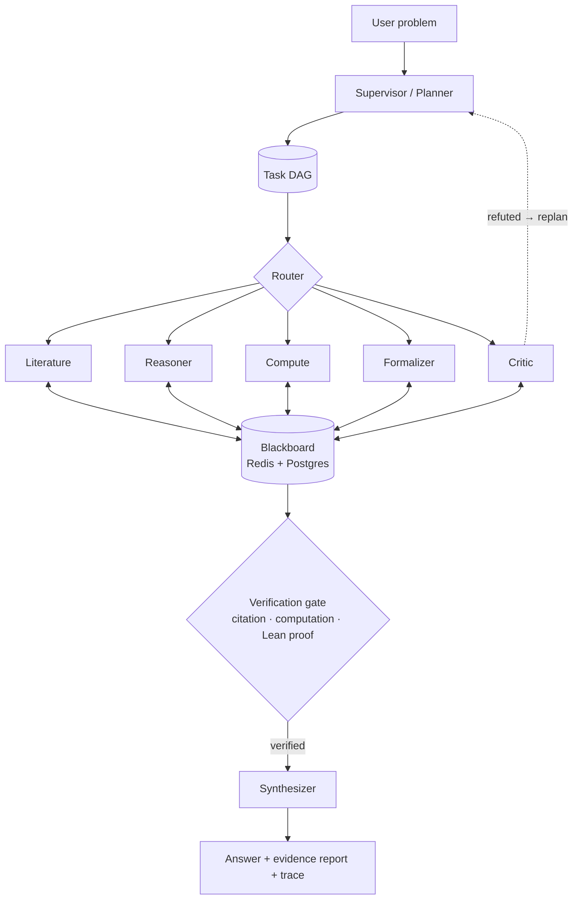

# Polymath Swarm

[](https://github.com/Gnanasudharsan/polymath-swarm/actions/workflows/ci.yml)
[](LICENSE)

**A verification-first multi-agent swarm for research and mathematics.**
A supervisor decomposes a problem into a task graph; specialist agents (literature, reasoning,
computation, formal verification, critique, synthesis) collaborate through a shared blackboard.
Every claim in the final answer carries evidence: a verified citation, a reproduced computation,
or a Lean 4 proof that compiles with zero `sorry`.

> **Status:** early development — Phase 0 (bootstrap). See [PROGRESS.md](PROGRESS.md).

## Architecture



More detail: [docs/architecture.md](docs/architecture.md) · decisions: [docs/adr/](docs/adr/).

## Stack

LangGraph · LiteLLM (Claude primary) · MCP · A2A · SymPy / sandboxed Python · Lean 4 + Mathlib ·
Postgres + pgvector · Redis · FastAPI + SSE · Next.js + React Flow · OpenTelemetry + Langfuse.

## Quickstart (development)

Prerequisites: [uv](https://docs.astral.sh/uv/), Docker, Node ≥ 20 (frontend, later phases).

```bash
git clone https://github.com/Gnanasudharsan/polymath-swarm.git && cd polymath-swarm
```

```bash
uv sync && uv run pre-commit install
```

```bash
cp .env.example .env
```

```bash
docker compose up -d --wait
```

```bash
uv run pytest -q
```

```bash
uv run polymath version
```

Postgres is exposed on host port **5544** and Redis on **6379**.

## Roadmap

| Phase | Scope |
|---|---|
| 0 | Bootstrap: tooling, CI, compose, docs |
| 1 | Core runtime: models, LLM gateway, budget, Reasoner, CLI |
| 2 | MCP tools: literature, sandbox, SymPy, Lean |
| 3 | Orchestration: LangGraph supervisor, DAG, blackboard, checkpoints |
| 4 | Specialists & verification loop |
| 5 | Memory & knowledge (pgvector, hybrid retrieval, episodic memory) |
| 6 | Evals, observability, cost |
| 7 | API & live frontend |
| 8 | A2A interop, hardening, v1.0.0 |

## License

[MIT](LICENSE)
