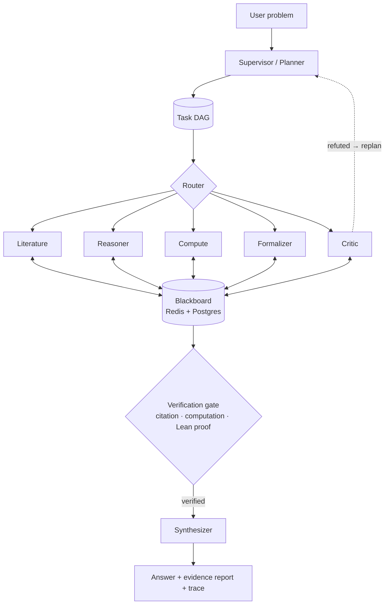

# Polymath Swarm

[](https://github.com/Gnanasudharsan/polymath-swarm/actions/workflows/ci.yml)
[](LICENSE)

**A verification-first multi-agent swarm for research and mathematics.**
A supervisor decomposes a problem into a task graph; specialist agents (literature, reasoning,
computation, formal verification, critique, synthesis) collaborate through a shared blackboard.
Every claim in the final answer carries evidence: a verified citation, a reproduced computation,
or a Lean 4 proof that compiles with zero `sorry`.

> **Status:** early development — Phase 3 (orchestration) complete. See [PROGRESS.md](PROGRESS.md).

## Architecture



More detail: [docs/architecture.md](docs/architecture.md) · decisions: [docs/adr/](docs/adr/).

## Stack

LangGraph · LiteLLM (Claude primary) · MCP · A2A · SymPy / sandboxed Python · Lean 4 + Mathlib ·
Postgres + pgvector · Redis · FastAPI + SSE · Next.js + React Flow · OpenTelemetry + Langfuse.

## Quickstart (development)

Prerequisites: [uv](https://docs.astral.sh/uv/), Docker, Node ≥ 20 (frontend, later phases).

```bash
git clone https://github.com/Gnanasudharsan/polymath-swarm.git && cd polymath-swarm
```

```bash
uv sync && uv run pre-commit install
```

```bash
cp .env.example .env
```

```bash
docker compose up -d --wait
```

```bash
uv run pytest -q
```

```bash
uv run polymath ask "Prove that the square root of 2 is irrational."
```

`ask` runs a single Reasoner (needs a provider key in `.env`; use `--model` to pick one, `--max-usd`
to cap spend, `--json` for machine-readable output). Claims it prints are *proposed* — the
verification pipeline arrives in later phases.

Postgres is exposed on host port **5544** and Redis on **6379**.

### Running the swarm

```bash
uv run polymath solve "Show that the product of two consecutive integers is even." --approve-plan
```

The supervisor plans a task DAG, you approve or give feedback, independent tasks run in parallel,
and every step is checkpointed in Postgres. Then you can:

```bash
uv run polymath resume <run_id>
```

```bash
uv run polymath trace <run_id> -o trace.json
```

Use `--memory` to run without Postgres/Redis. Specialist agents arrive in Phase 4; until then
every role is served by the Reasoner.

### Tool servers (MCP)

Build the tool images once (the Lean + Mathlib image is large, about 15 GB):

```bash
docker compose --profile tools build
```

Each server speaks MCP over stdio and works with any MCP client:

| Server | Command | Tools |
|---|---|---|
| SymPy | `uv run python -m polymath.mcp_servers.sympy` | simplify, solve, integrate, series, verify_identity |
| Sandbox | `uv run python -m polymath.mcp_servers.sandbox` | run_python (no network, read-only FS, resource caps) |
| Literature | `uv run python -m polymath.mcp_servers.literature` | arXiv, Semantic Scholar, OpenAlex search and lookup |
| Lean | `uv run python -m polymath.mcp_servers.lean` | check, get_goals, count_sorry, verify_proof |

```bash
uv run pytest -m integration -q
```

## Roadmap

| Phase | Scope |
|---|---|
| 0 | Bootstrap: tooling, CI, compose, docs |
| 1 | Core runtime: models, LLM gateway, budget, Reasoner, CLI |
| 2 | MCP tools: literature, sandbox, SymPy, Lean |
| 3 | Orchestration: LangGraph supervisor, DAG, blackboard, checkpoints |
| 4 | Specialists & verification loop |
| 5 | Memory & knowledge (pgvector, hybrid retrieval, episodic memory) |
| 6 | Evals, observability, cost |
| 7 | API & live frontend |
| 8 | A2A interop, hardening, v1.0.0 |

## License

[MIT](LICENSE)
