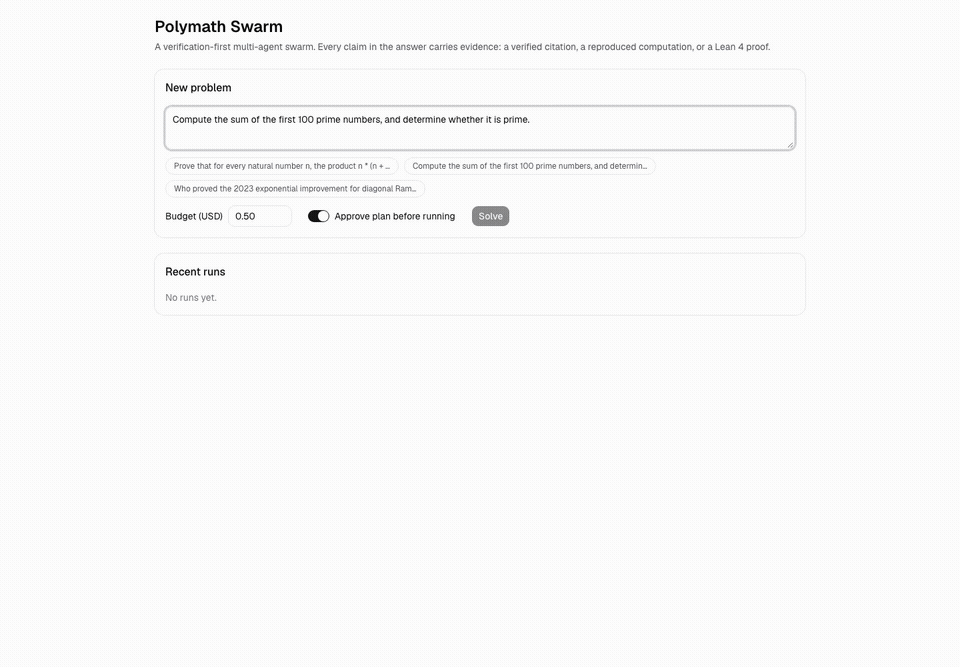
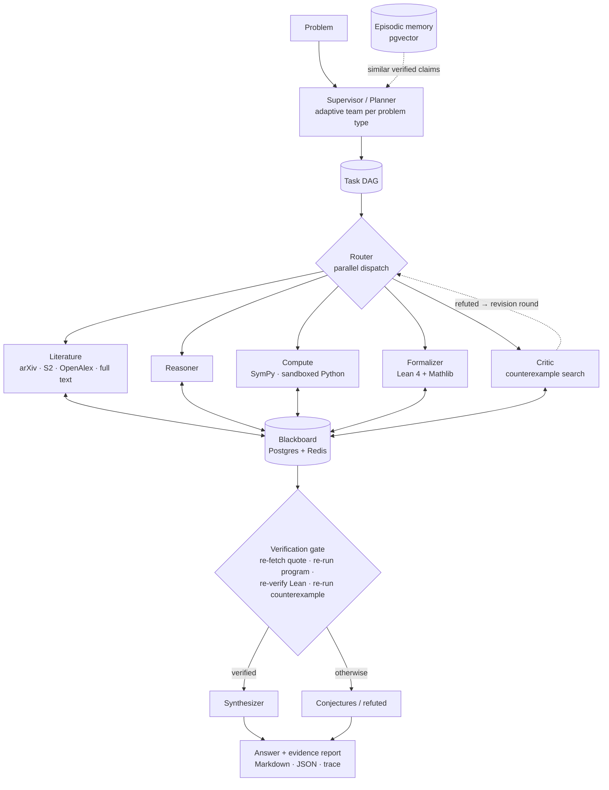

# Polymath Swarm

[](https://github.com/Gnanasudharsan/polymath-swarm/actions/workflows/ci.yml)
[](LICENSE)

**A verification-first multi-agent swarm for research and mathematics.** A supervisor breaks a
problem into a task graph, and specialist agents (literature, reasoning, computation, Lean 4
formalization, critique, synthesis) work on it in parallel. **Every claim in the final answer
carries evidence that is re-checked independently**: a citation whose quote is re-found in the
paper, a computation that is re-run in a sandbox, or a Lean 4 proof that compiles with zero
`sorry` and only standard axioms. Anything unproven is reported as a conjecture.



## Why

LLMs are fluent and often wrong, and the errors look just like the right answers. Polymath Swarm
never takes an agent's word for anything. Agents produce *artifacts* (search queries, check
programs, Lean proofs, counterexample searches). Code runs them through sandboxed tools, and a
**verification gate** reproduces every piece of evidence before a claim may appear in the answer.

## How it works



- **Orchestration:** LangGraph, with a Postgres checkpointer, so runs resume after a pause, crash or `kill -9`. Human plan approval is optional, and budgets cap USD, tokens, wall clock and iterations.
- **Tools:** every tool is an MCP server (literature, sandbox, sympy, lean, knowledge).
- **Memory:** papers are ingested into pgvector for hybrid retrieval (full-text + vector, rank fusion, local cross-encoder rerank). Verified claims from past runs are recalled, then re-verified.
- **Interop:** the swarm and each specialist are A2A agents, and roles can be delegated to external A2A agents.
- **Observability:** OpenTelemetry traces go to self-hosted Langfuse, with every agent, tool and LLM call and its cost.

Details: [docs/architecture.md](docs/architecture.md) · design decisions: [docs/adr/](docs/adr/) ·
threat model: [docs/security.md](docs/security.md).

## Results

Single agent (one LLM call, same models and checkers) vs. the swarm, from
[evals/reports/2026-11-05](evals/reports/2026-11-05/report.md). Small samples, so these numbers
are indicative. The run used the OpenAI profile (gpt-5 for Lean, gpt-5-mini elsewhere), with
deterministic scoring.

| Suite | n | Single agent | Swarm | Swarm claims verified | Hallucinated citations (single → swarm) | $/problem (single → swarm) |
|---|---|---|---|---|---|---|
| miniF2F (Lean 4, `mathd_*`) | 3 | 0% | **33%** | 5% | n/a | 0.14 → 0.12 |
| MATH Level 5 | 6 | 100% | 100% | 64% | n/a | 0.0005 → 0.007 |
| Research QA | 6 | **67%** | 33% | 100% | **50% → 0%** | 0.001 → 0.006 |

The swarm trades coverage for trust. It proves what the single agent can't, matches it on MATH
while backing most of its claims with re-run computations, and never cites a paper that doesn't
say what it claims. The single agent answered more research questions, but half of its citations
were unsupported. Hybrid retrieval on a labelled set reaches **recall@10 = 0.983, MRR = 0.950**.

End-to-end demos with committed evidence reports and traces are in [examples/](examples/README.md).
They cover a Lean-verified proof, a reproduced computation, verified literature quotes, and lemma
reuse from memory.

## Quickstart

**Prerequisites:** Docker, [uv](https://docs.astral.sh/uv/), and an LLM provider key
(Anthropic by default; OpenAI works with `POLYMATH_MODEL_PROFILE=openai`). Node ≥ 20 only if you
develop the UI.

```bash
git clone https://github.com/Gnanasudharsan/polymath-swarm.git && cd polymath-swarm
```

```bash
cp .env.example .env
```

Edit `.env`: set `ANTHROPIC_API_KEY` (or `OPENAI_API_KEY` plus `POLYMATH_MODEL_PROFILE=openai`), and
set `POLYMATH_API_KEY` to any secret string for the HTTP API.

### Option A: the whole stack (API + web UI), one command

```bash
docker compose --profile app up -d --build
```

Open **http://localhost:3100**. The API is on http://localhost:8000, and the A2A Agent Card is at
http://localhost:8000/.well-known/agent-card.json.

### Option B: the CLI

```bash
docker compose up -d --wait
```

```bash
docker compose --profile tools build sandbox
```

```bash
uv sync
```

```bash
uv run polymath solve "Compute the sum of the first 100 primes; is it prime?" --max-usd 0.5
```

The evidence report is written to `reports/<run_id>.md` and `.json`. Useful flags:
`--approve-plan` (review the plan first), `--memory` (no Postgres/Redis), `--no-tools`.

### Optional extras

| What | Command | Notes |
|---|---|---|
| Lean 4 + Mathlib | `docker compose --profile tools build lean` | about 15 GB; enables formal proofs |
| Langfuse tracing | `docker compose --profile observability up -d --wait` | UI on :3000; set `LANGFUSE_*` (see `.env.example`) |
| Free scripted demo | `POLYMATH_API_KEY=x uv run polymath serve --memory --mock-llm` | mock LLM; real sandbox and gate |

## A2A interop

The swarm is an [A2A](https://a2a-protocol.org) agent. Each specialist (literature, reasoner,
compute, formalizer, critic) is too, at `/agents/<role>/`. Cards are public; calls need the
`x-api-key` header.

```bash
POLYMATH_API_KEY=... uv run python examples/a2a_client.py "Is 2^10 + 1 prime?"
```

```bash
POLYMATH_API_KEY=... uv run python examples/a2a_client.py --agent compute "Is 97 prime?"
```

To delegate a role to an external A2A agent, set
`POLYMATH_A2A_DELEGATES={"literature": "https://other-agent.example"}`. Its replies are treated
as untrusted proposals and can never be "verified" on the remote's word.

## CLI

| Command | What it does |
|---|---|
| `polymath solve "…"` | plan and run the swarm; writes the evidence report |
| `polymath resume <run_id>` | continue a paused (plan approval) or interrupted run |
| `polymath trace <run_id> -o t.json` | export the full trace (plan, results, claims, events) |
| `polymath serve` | HTTP API with SSE and A2A (`--memory`, `--mock-llm`) |
| `polymath eval --suite all --n 5` | single agent vs swarm on miniF2F, MATH, research QA |
| `polymath ask "…"` | one Reasoner call (no verification) |
| `polymath graph` | the orchestration graph as Mermaid |

## Configuration

All settings come from environment variables or `.env` (see `.env.example` and
`src/polymath/core/config.py`).

| Variable | Default | Purpose |
|---|---|---|
| `POLYMATH_MODEL_PROFILE` | `anthropic` | `anthropic` (Claude) or `openai` |
| `POLYMATH_ROLE_MODELS` | from profile | per-role model override (JSON) |
| `POLYMATH_API_KEY` | (none) | one API key (the user `admin`); this or `API_USERS` is required |
| `POLYMATH_API_USERS` / `POLYMATH_API_ADMINS` | `{}` / `["admin"]` | named users with hashed keys; non-admins see only their own runs |
| `POLYMATH_RATE_LIMIT_BACKEND` | `memory` | `redis` shares limits across API replicas (on in compose) |
| `POLYMATH_SPEND_LEDGER` / `POLYMATH_SPEND_CAP_USD` | off | hard cap on total spend across runs |
| `POLYMATH_MEMORY_ENABLED` | `true` | episodic memory and claim reuse |
| `POLYMATH_A2A_DELEGATES` | `{}` | route roles to external A2A agents |
| `POLYMATH_API_WRITES_PER_MINUTE` / `_READS_` | 20 / 600 | API rate limits per client |

### Multiple users

```bash
uv run polymath keys new alice
```

This prints Alice's key (shown once) and a hash entry. Put the hash entries in
`POLYMATH_API_USERS={"alice":"sha256:...","bob":"sha256:..."}`. Each user sees only the runs they
started, over REST and A2A; users in `POLYMATH_API_ADMINS` see all of them. The web UI uses the key
in its own `POLYMATH_API_KEY`, so it acts as that one user.

## Limitations

- **Small evaluations.** The published comparison uses 3–6 problems per suite because of budget,
  and miniF2F is sampled from the easier `mathd_*` problems.
- **Verification-first means abstaining.** With no verified claim, the swarm says so rather than guessing, which can lower accuracy on questions a single model answers correctly from memory.
- **Lean image size.** Lean needs a 15 GB image and about 3.5 GB of RAM per REPL. Without it, proofs cannot be verified (other evidence still works).
- **Docker socket.** The containerised API reaches the Docker socket to start sandboxes, which is root-equivalent on the host. Bind it to localhost and see [docs/security.md](docs/security.md).
- **Simple users.** Users and hashed keys live in configuration (no sign-up, no per-user spend quotas, only user/admin roles).
- **Paraphrase in research QA.** Keyword scoring penalises paraphrase, and literature results vary run to run because search ranking does.
- **Claude profile untested live.** The Anthropic profile is the default but was not exercised live during development, which used the OpenAI profile.

## Development

```bash
uv sync && uv run pre-commit install
```

```bash
uv run ruff check . && uv run ruff format --check . && uv run mypy src && uv run pytest -q
```

```bash
uv run pytest -m integration -q
```

Integration tests need Docker. Their `lean` and `network` subsets need the Lean image and internet
access; `live` tests call real models. The frontend e2e runs with
`cd frontend && npx playwright test`. Project memory for contributors and coding agents is in
[CLAUDE.md](CLAUDE.md); history is in [PROGRESS.md](PROGRESS.md) and [CHANGELOG.md](CHANGELOG.md).

## License

[MIT](LICENSE)
