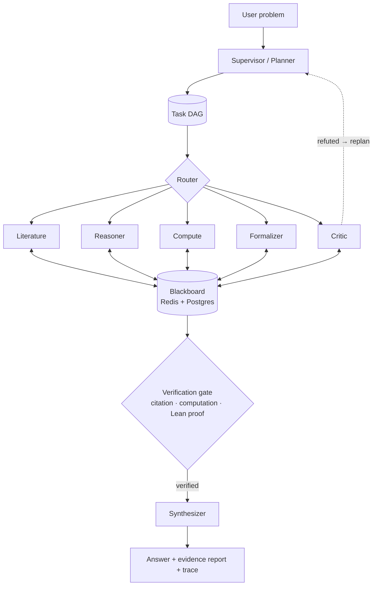
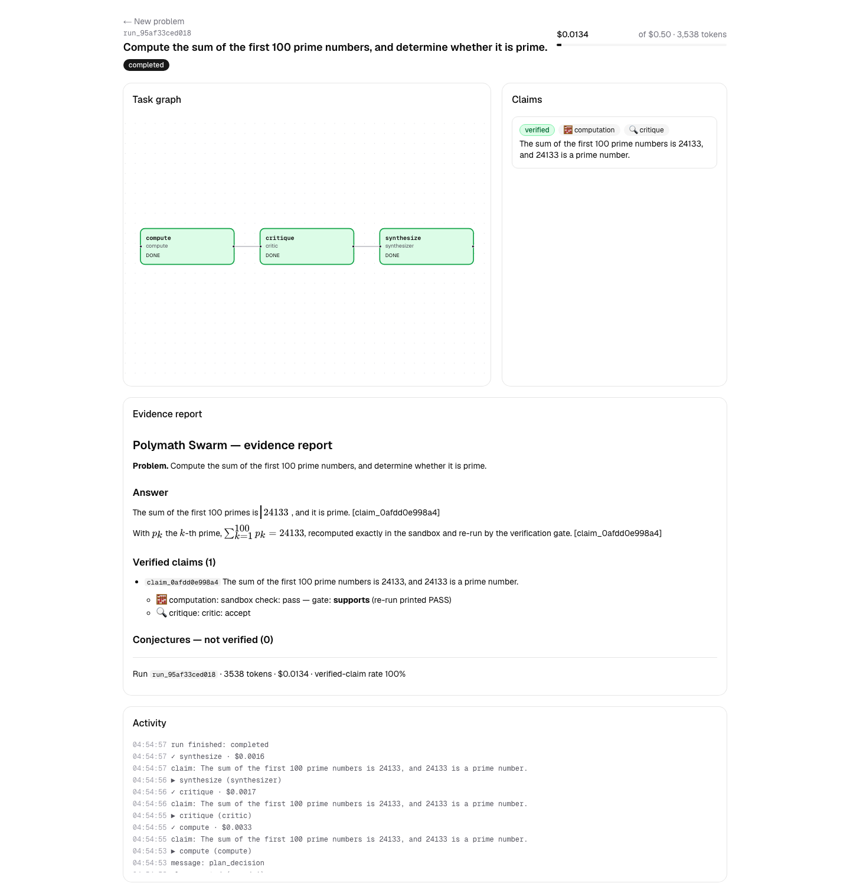
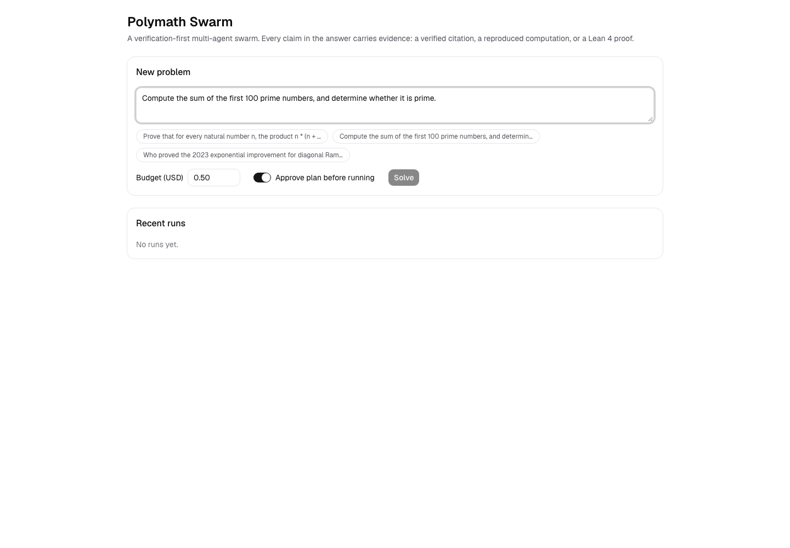
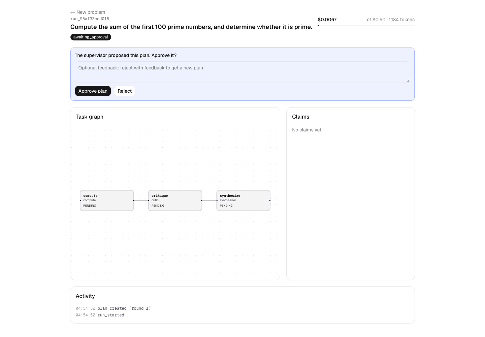
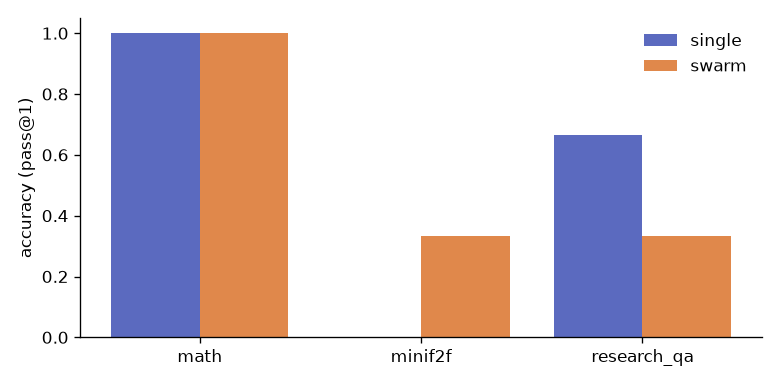

# Polymath Swarm

[](https://github.com/Gnanasudharsan/polymath-swarm/actions/workflows/ci.yml)
[](LICENSE)

**A verification-first multi-agent swarm for research and mathematics.**
A supervisor decomposes a problem into a task graph; specialist agents (literature, reasoning,
computation, formal verification, critique, synthesis) collaborate through a shared blackboard.
Every claim in the final answer carries evidence: a verified citation, a reproduced computation,
or a Lean 4 proof that compiles with zero `sorry`.

> **Status:** early development — Phase 7 (API & live UI) complete. See [PROGRESS.md](PROGRESS.md).

## Architecture



More detail: [docs/architecture.md](docs/architecture.md) · decisions: [docs/adr/](docs/adr/).

## Stack

LangGraph · LiteLLM (Claude primary) · MCP · A2A · SymPy / sandboxed Python · Lean 4 + Mathlib ·
Postgres + pgvector · Redis · FastAPI + SSE · Next.js + React Flow · OpenTelemetry + Langfuse.

## Quickstart (development)

Prerequisites: [uv](https://docs.astral.sh/uv/), Docker, Node ≥ 20 (frontend, later phases).

```bash
git clone https://github.com/Gnanasudharsan/polymath-swarm.git && cd polymath-swarm
```

```bash
uv sync && uv run pre-commit install
```

```bash
cp .env.example .env
```

```bash
docker compose up -d --wait
```

```bash
uv run pytest -q
```

```bash
uv run polymath ask "Prove that the square root of 2 is irrational."
```

`ask` runs a single Reasoner (needs a provider key in `.env`; use `--model` to pick one, `--max-usd`
to cap spend, `--json` for machine-readable output). Claims it prints are *proposed* — the
verification pipeline arrives in later phases.

Postgres is exposed on host port **5544** and Redis on **6379**.

### Running the swarm

```bash
uv run polymath solve "Show that the product of two consecutive integers is even." --approve-plan
```

The supervisor plans a task DAG, you approve or give feedback, independent tasks run in parallel,
and every step is checkpointed in Postgres. Then you can:

```bash
uv run polymath resume <run_id>
```

```bash
uv run polymath trace <run_id> -o trace.json
```

Every run ends with an evidence report (`reports/<run_id>.md` and `.json`): the answer cites
only claims that passed the verification gate, and everything else is listed as a conjecture or
refuted. Use `--memory` to run without Postgres/Redis and `--no-tools` for a Reasoner-only dry run.

### Demos

| Problem | Verified by | Cost |
|---|---|---|
| n·(n+1) is even for all n ∈ ℕ | Lean 4 + Mathlib proof, back-translation judged faithful | $0.063 |
| Sum of the first 100 primes (24133, prime) | sandbox computation, re-run by the gate | $0.011 |
| 2023 exponential improvement for diagonal Ramsey numbers | verbatim quotes in re-fetched arXiv abstracts | $0.007 |
| n·(n+1)·(n+2) is even, after an earlier run proved it | recalled from episodic memory, Lean proof re-verified | $0.096 |

### Memory

Papers are ingested (arXiv PDF → chunks → local embeddings) into Postgres + pgvector and searched
with hybrid retrieval (full-text + vectors, rank fusion, cross-encoder rerank). On the labeled
retrieval set ([evals/reports](evals/reports/)), hybrid + rerank reaches **recall@10 = 0.983, MRR =
0.950**. Every run's verified claims are remembered; related runs recall them, and the gate
re-verifies them before use. Embedding models run locally (about 130 MB, downloaded once).

Reports and full traces are in [examples/](examples/README.md). To run with OpenAI only, set
`POLYMATH_MODEL_PROFILE=openai` in `.env`. Set `POLYMATH_SPEND_CAP_USD` to cap total spend.

### Tool servers (MCP)

Build the tool images once (the Lean + Mathlib image is large, about 15 GB):

```bash
docker compose --profile tools build
```

Each server speaks MCP over stdio and works with any MCP client:

| Server | Command | Tools |
|---|---|---|
| SymPy | `uv run python -m polymath.mcp_servers.sympy` | simplify, solve, integrate, series, verify_identity |
| Sandbox | `uv run python -m polymath.mcp_servers.sandbox` | run_python (no network, read-only FS, resource caps) |
| Literature | `uv run python -m polymath.mcp_servers.literature` | arXiv, Semantic Scholar, OpenAlex search and lookup |
| Lean | `uv run python -m polymath.mcp_servers.lean` | check, get_goals, count_sorry, verify_proof |

```bash
uv run pytest -m integration -q
```

## Web UI



A live task graph (nodes light up as agents work), claims with evidence badges (📚 citation ·
🧮 computation · ✅ Lean · ♻️ memory), a cost meter, plan approval and the evidence report with
KaTeX maths. Start the API, then the UI:

```bash
POLYMATH_API_KEY=change-me uv run polymath serve --port 8000
```

```bash
cd frontend && npm install && POLYMATH_API_URL=http://localhost:8000 POLYMATH_API_KEY=change-me npm run dev -- -p 3100
```

Open http://localhost:3100. Add `--mock-llm` to `serve` for a free, scripted demo run (the
sandbox and the verification gate still run for real). The API: `POST /runs`, `GET /runs/{id}`,
`GET /runs/{id}/stream` (SSE), `POST /runs/{id}/approve`, all with an `x-api-key` header.

<p float="left">
  
  
</p>

## Results: single agent vs swarm

From [evals/reports/2026-11-05](evals/reports/2026-11-05/report.md). Small samples, indicative
only. OpenAI profile (gpt-5 for Lean, gpt-5-mini elsewhere); deterministic scoring.

| Suite | n | Single agent | Swarm | Swarm verified-claim rate | Hallucinated citations (single → swarm) | $/problem (single → swarm) |
|---|---|---|---|---|---|---|
| miniF2F (Lean 4, `mathd_*`) | 3 | 0% | **33%** | 5% | n/a | $0.14 → $0.12 |
| MATH Level 5 | 6 | 100% | 100% | 64% | n/a | $0.0005 → $0.007 |
| Research QA | 6 | **67%** | 33% | 100% | **50% → 0%** | $0.001 → $0.006 |



The swarm trades coverage for trust. It proves what the single agent can't (miniF2F), matches it on
MATH while backing 64% of its claims with re-run computations, and on research questions never
cites a paper that doesn't say what it claims. The single agent got more research answers "right",
but half of its citations were unsupported. Reproduce with `uv run polymath eval --suite all --n 5`.

### Observability

```bash
docker compose --profile observability up -d --wait
```

With `LANGFUSE_HOST/PUBLIC_KEY/SECRET_KEY` set (see `.env.example`), every run is a trace in
self-hosted Langfuse at http://localhost:3000: one span per agent task and tool call, plus every
LLM generation with model, tokens and cost.

## Roadmap

| Phase | Scope |
|---|---|
| 0 | Bootstrap: tooling, CI, compose, docs |
| 1 | Core runtime: models, LLM gateway, budget, Reasoner, CLI |
| 2 | MCP tools: literature, sandbox, SymPy, Lean |
| 3 | Orchestration: LangGraph supervisor, DAG, blackboard, checkpoints |
| 4 | Specialists & verification loop |
| 5 | Memory & knowledge (pgvector, hybrid retrieval, episodic memory) |
| 6 | Evals, observability, cost |
| 7 | API & live frontend |
| 8 | A2A interop, hardening, v1.0.0 |

## License

[MIT](LICENSE)
