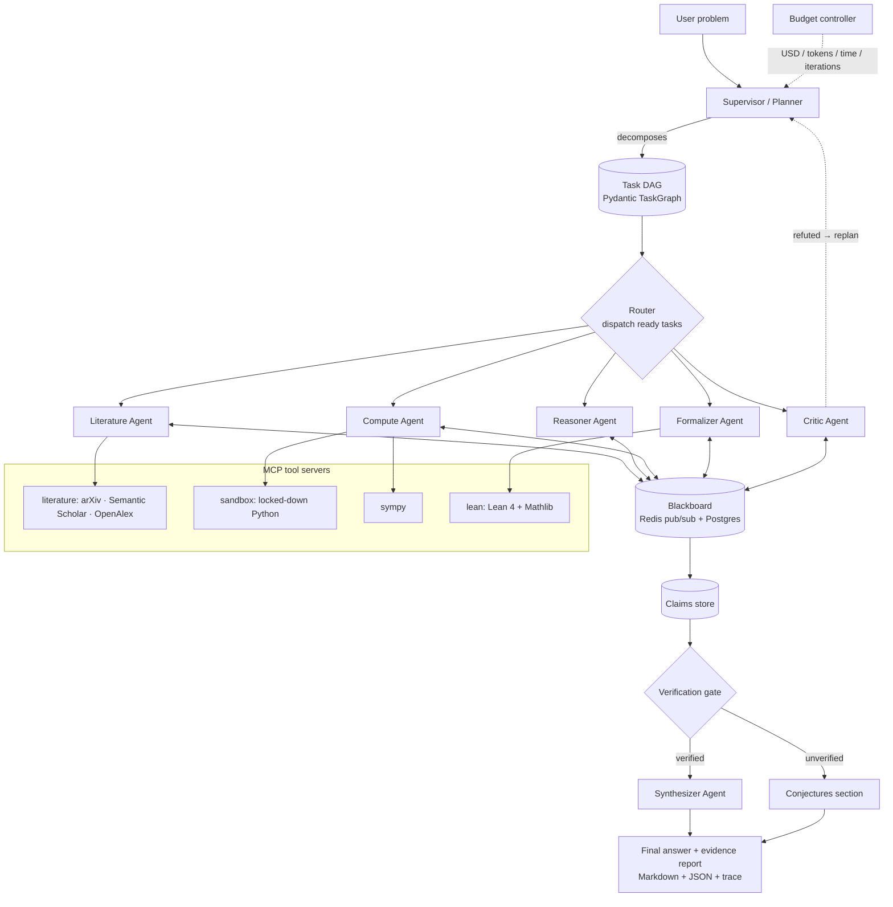
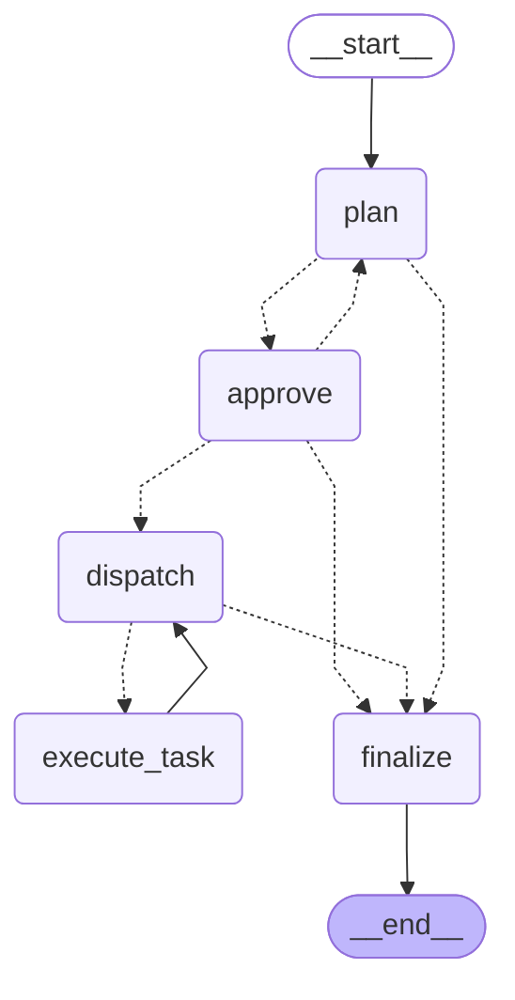
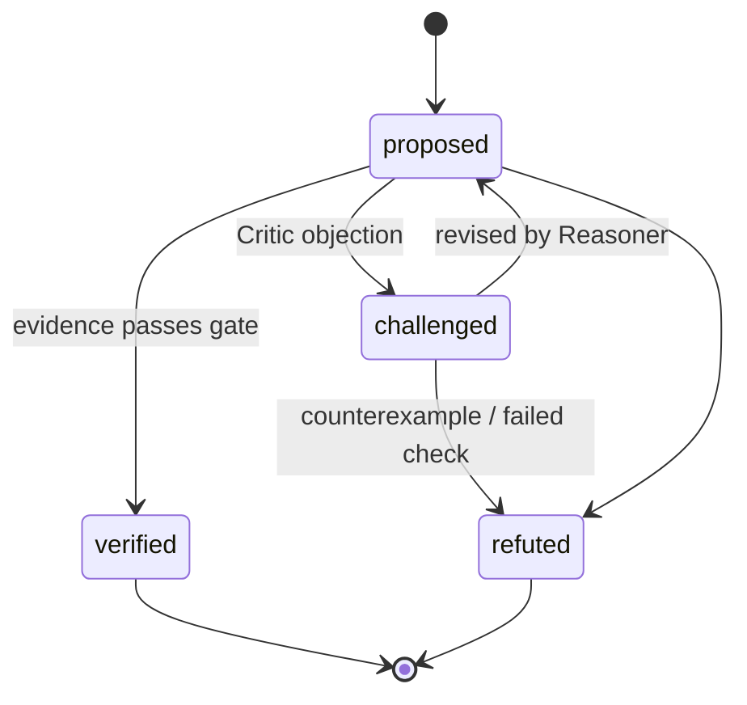

# Architecture

Polymath Swarm is a **verification-first** multi-agent system: no claim reaches the final answer
unless it carries machine-checkable evidence.

## System overview

## Components

| Component | Module | Responsibility | Phase |
|---|---|---|---|
| Core models | `polymath.core` | `Problem`, `Task`, `TaskGraph`, `Claim`, `Evidence`, `AgentMessage`, `BlackboardEvent`, `RunBudget`; settings, logging, tracing | 1 |
| LLM gateway | `polymath.llm` | LiteLLM routing, role→model map, retries, structured output, cost accounting | 1 |
| Agents | `polymath.agents` | `BaseAgent` + six specialists; prompts versioned under `agents/prompts/` | 1, 4 |
| Tools | `polymath.mcp_servers` | FastMCP servers: literature, sandbox, sympy, lean; MCP client adapter | 2 |
| Orchestration | `polymath.graph` | LangGraph `StateGraph`, supervisor, router, Postgres checkpointer, HITL interrupts | 3 |
| Blackboard | `polymath.blackboard` | Redis pub/sub for live events, Postgres for durable history | 3 |
| Memory | `polymath.memory` | pgvector paper chunks, hybrid retrieval, episodic memory, claims store | 5 |
| Interop | `polymath.a2a` | A2A Agent Cards, server and client | 8 |
| API | `polymath.api` | FastAPI, SSE run streaming, API-key auth | 7 |
| Frontend | `frontend/` | Next.js + React Flow live task graph, claim panel, cost meter | 7 |

## Orchestration graph (LangGraph)

Generated from the code with `uv run polymath graph` (see ADR-0005):

- `plan` — Supervisor/Planner turns the problem into a validated task DAG.
- `approve` — optional human-in-the-loop `interrupt()`; feedback triggers a replan.
- `dispatch` — syncs the budget from the checkpoint, stops when exhausted or done.
- `execute_task` — one parallel branch per ready task (`Send`), each running a specialist.
- `finalize` — final task statuses, answer, `run_finished` event.

Runs are checkpointed in Postgres after every step (`run_id` = thread id), so
`polymath resume <run_id>` continues after a pause, crash or `kill -9`.

## Claim lifecycle

Evidence accepted by the gate:

- **citation** — the quoted source text was retrieved and actually supports the claim
- **computation** — code re-executed in the sandbox reproduces the result
- **formal_proof** — the Lean 4 file compiles against Mathlib with zero `sorry`/`admit`

## Budget & degradation

Every run carries a `RunBudget` (max USD, tokens, wall-clock, iterations). The supervisor checks
remaining budget before dispatching; near the ceiling it drops optional critics and routes to cheaper
models, and at the ceiling it terminates and synthesizes with whatever has been verified.

## Tool layer (MCP)

| Server | Module | Tools | Isolation |
|---|---|---|---|
| `sympy` | `mcp_servers/sympy` | `simplify`, `solve`, `integrate`, `series`, `verify_identity` | input screen + killable child process |
| `sandbox` | `mcp_servers/sandbox` | `run_python` | throwaway Docker container: no network, read-only FS, mem/CPU/PID caps, uid 65534 |
| `literature` | `mcp_servers/literature` | `arxiv_search`, `arxiv_fetch`, `semantic_scholar_search`, `semantic_scholar_citations`, `openalex_search`, `openalex_lookup` | Redis cache + shared rate limiter |
| `lean` | `mcp_servers/lean` | `check`, `get_goals`, `count_sorry`, `verify_proof` | persistent network-less REPL container with Mathlib loaded once |

Agents reach tools through `MCPToolbox` (`mcp_servers/client.py`), which mounts several servers,
namespaces tools as `server.tool`, and exports LiteLLM function schemas. See ADR-0003 and ADR-0004.

## Infrastructure (dev)

`docker compose up -d --wait` starts Postgres 16 + pgvector (host port 5544) and Redis 7 (6379).
`docker compose --profile tools build` builds the sandbox image and the Lean + Mathlib image
(~15 GB). Langfuse and the API are added in later phases.
