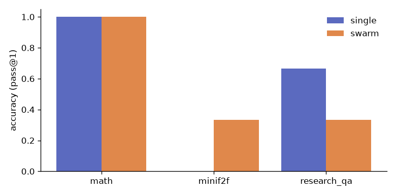
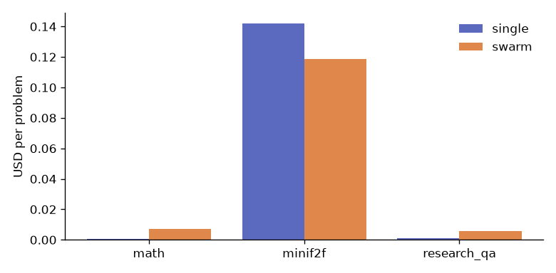

# Polymath Swarm — eval report (2026-11-05)

Single agent (one LLM call per problem, same models and checkers) vs. the full swarm (planning,
specialists, critique loop, Lean repair + automation, verification gate; memory disabled).
Model profile `openai`: gpt-5 for Lean/formalization, gpt-5-mini elsewhere. Per-problem cap
$0.25 per system. **Small samples** (stated per suite), so treat differences as indicative.
Scoring is deterministic: numeric equivalence (MATH), all answer keywords present (research QA),
and a gate-verified Lean proof that keeps the benchmark statement verbatim (miniF2F).

## Findings (2026-11-05 run)

- **miniF2F**: the swarm proved 1/3 (Lean repair + Mathlib automation), the single agent 0/3, and
  the swarm was cheaper per problem ($0.12 vs $0.14), because its gpt-5 calls were shorter.
- **MATH (Level 5)**: both 6/6. The swarm costs about 15 times more ($0.007 vs $0.0005 per
  problem) and backs 64% of its claims with re-run computations; the single agent's answers carry
  no evidence.
- **Research QA**: the single agent answered more (4/6 vs 2/6) but **3 of its 6 citations were
  unsupported** (quote not found in the re-fetched paper): a 50% hallucinated-citation rate. Every
  swarm citation (15/15) was verified. The swarm's misses come from verification-first behaviour
  (it abstained on ResNet when search did not surface the original paper) and from strict keyword
  scoring (e.g. "generative model" instead of "generator"). The scorer was fixed before the run and
  was not changed after seeing results.
- An earlier attempt of this run was invalidated when the OpenAI account ran out of credit; only
  the affected attempts were re-run (`evals/runners/rerun_failed.py`), so no valid result was
  replaced.

## Summary

| suite | system | n | accuracy | verified-claim rate | hallucinated-citation rate | $ / problem | latency / problem | errors |
|---|---|---|---|---|---|---|---|---|
| minif2f | single | 3 | 0% | n/a | n/a | $0.1419 | 131 s | 0 |
| minif2f | swarm | 3 | 33% | 5% | n/a | $0.1188 | 168 s | 0 |
| math | single | 6 | 100% | n/a | n/a | $0.0005 | 7 s | 0 |
| math | swarm | 6 | 100% | 64% | n/a | $0.0073 | 46 s | 0 |
| research_qa | single | 6 | 67% | n/a | 50% | $0.0011 | 11 s | 0 |
| research_qa | swarm | 6 | 33% | 100% | 0% | $0.0056 | 51 s | 0 |

## Per problem

| suite | problem | system | correct | verified claims | $ | latency |
|---|---|---|---|---|---|---|
| minif2f | mathd_numbertheory_328 | single | ❌ | 0/0 | $0.1455 | 149 s |
| minif2f | mathd_numbertheory_328 | swarm | ✅ | 1/6 | $0.1695 | 140 s |
| minif2f | mathd_numbertheory_435 | single | ❌ | 0/0 | $0.2250 | 196 s |
| minif2f | mathd_numbertheory_435 | swarm | ❌ | 0/7 | $0.0076 | 34 s |
| minif2f | mathd_algebra_148 | single | ❌ | 0/0 | $0.0551 | 47 s |
| minif2f | mathd_algebra_148 | swarm | ❌ | 0/7 | $0.1793 | 328 s |
| math | counting_and_probability_262 | single | ✅ | 0/0 | $0.0004 | 4 s |
| math | counting_and_probability_262 | swarm | ✅ | 4/9 | $0.0130 | 79 s |
| math | prealgebra_46 | single | ✅ | 0/0 | $0.0003 | 10 s |
| math | prealgebra_46 | swarm | ✅ | 1/1 | $0.0062 | 30 s |
| math | algebra_129 | single | ✅ | 0/0 | $0.0008 | 10 s |
| math | algebra_129 | swarm | ✅ | 1/1 | $0.0061 | 40 s |
| math | number_theory_278 | single | ✅ | 0/0 | $0.0004 | 3 s |
| math | number_theory_278 | swarm | ✅ | 1/1 | $0.0060 | 35 s |
| math | prealgebra_263 | single | ✅ | 0/0 | $0.0004 | 6 s |
| math | prealgebra_263 | swarm | ✅ | 1/1 | $0.0084 | 46 s |
| math | prealgebra_209 | single | ✅ | 0/0 | $0.0005 | 6 s |
| math | prealgebra_209 | swarm | ✅ | 1/1 | $0.0042 | 45 s |
| research_qa | rqa_dropout_bn | single | ✅ | 0/0 | $0.0011 | 6 s |
| research_qa | rqa_dropout_bn | swarm | ✅ | 4/4 | $0.0066 | 60 s |
| research_qa | rqa_alphago | single | ❌ | 0/0 | $0.0019 | 40 s |
| research_qa | rqa_alphago | swarm | ❌ | 3/3 | $0.0066 | 99 s |
| research_qa | rqa_adam | single | ✅ | 0/0 | $0.0009 | 5 s |
| research_qa | rqa_adam | swarm | ❌ | 2/2 | $0.0045 | 44 s |
| research_qa | rqa_transformer | single | ✅ | 0/0 | $0.0010 | 5 s |
| research_qa | rqa_transformer | swarm | ✅ | 1/1 | $0.0050 | 27 s |
| research_qa | rqa_resnet | single | ✅ | 0/0 | $0.0008 | 6 s |
| research_qa | rqa_resnet | swarm | ❌ | 3/3 | $0.0055 | 38 s |
| research_qa | rqa_gans | single | ❌ | 0/0 | $0.0010 | 4 s |
| research_qa | rqa_gans | swarm | ❌ | 2/2 | $0.0053 | 36 s |
